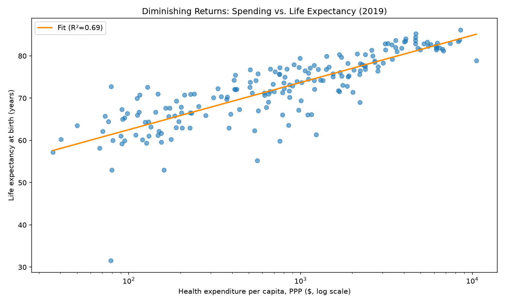

# Does Healthcare Spending Buy Longer Life?

**An analysis of how healthcare spending relates to life expectancy across 193 countries (2000–2023), testing for diminishing returns and examining the United States as a high-spending outlier.**



---

## The Question

The United States spends more per person on healthcare than any other country on Earth and still doesn't have the longest life expectancy. This project uses World Bank data covering 2000–2023 to test whether spending more actually buys a longer life, and where the relationship breaks down.

## Data

| | |
|---|---|
| **Source** | [World Bank](https://data.worldbank.org/), via [Our World in Data](https://ourworldindata.org/grapher/life-expectancy-vs-healthcare-expenditure) |
| **Coverage** | 193 countries |
| **Time range** | 2000–2023 |
| **Key variables** | Healthcare expenditure per capita (PPP-adjusted), life expectancy at birth |
| **Snapshot year** | 2019 (full 193-country coverage, before COVID-era disruption) |

## Methodology

1. **Clean**: dropped rows missing either variable, removed regional aggregates (e.g. "World", "Europe"), and filtered out implausible values (`src/01_clean.py`)
2. **Explore**: checked year-over-year country coverage and summary statistics to choose a reliable snapshot year (`src/02_explore.py`)
3. **Visualize**: built a cross-country scatter plot (log-scaled spending) and a multi-country time trend (`src/03_visualize.py`)
4. **Quantify**: fit a linear regression on log-transformed spending to test for a diminishing-returns pattern (`src/04_analyze.py`)

## Key Findings

**1. Spending and life expectancy are positively correlated, but not linearly.**
Across 193 countries in 2019, the correlation is **r ≈ 0.70** (0.66 across all years, 2000–2023).

**2. Diminishing returns are real and measurable.**
A regression on log-transformed spending explains **69% of the variation** in life expectancy (R² = 0.693, p < 0.001). Each 10x increase in healthcare spending is associated with roughly **11 additional years** of life expectancy on average, which means each extra dollar buys less at higher spending levels.

**3. The United States is the clearest outlier.**
The US spends more per capita than any other country, yet trails peer nations like Germany, Japan, and the UK in life expectancy, and that gap is wider in 2023 than it was in 2000.

## Takeaway

Money matters most where there's little of it. Past a certain point, *how* a country spends may matter more than *how much*. The US illustrates that high spending alone doesn't guarantee better results.

## Visualizations

| Chart | Description |
|---|---|
| `images/spending_vs_life_expectancy_2019.png` | Cross-country scatter, 2019, with the US highlighted |
| `images/life_expectancy_trend.png` | Life expectancy over time, US vs. Germany, Japan, UK |
| `images/diminishing_returns.png` | Scatter with fitted regression line on log-scaled spending |

## Project Structure

```
healthcare-spending-life-expectancy/
├── README.md
├── requirements.txt
├── .gitignore
├── data/
│   └── raw/                   # source CSV from Our World in Data
├── src/
│   ├── 01_clean.py            # load, rename, filter
│   ├── 02_explore.py          # coverage checks, summary stats, correlation
│   ├── 03_visualize.py        # scatter plot, time trend
│   └── 04_analyze.py          # regression, diminishing-returns chart
└── images/                    # exported chart PNGs
```

## How to Run

### 1. Clone the repository (all systems)

```bash
git clone https://github.com/SALAHDDINEDKAKI/healthcare-spending-life-expectancy.git
cd healthcare-spending-life-expectancy
```

### 2. Create and activate a virtual environment

**macOS / Linux**

```bash
python3 -m venv .venv
source .venv/bin/activate
```

**Windows (Command Prompt or PowerShell)**

```bash
python -m venv .venv
.venv\Scripts\activate
```

### 3. Install dependencies (all systems)

```bash
pip install -r requirements.txt
```

### 4. Run the pipeline (all systems)

```bash
python src/01_clean.py
python src/02_explore.py
python src/03_visualize.py
python src/04_analyze.py
```

## Limitations

- Correlation is not causation: spending is one of many factors (diet, sanitation, healthcare system design, inequality) that shape life expectancy.
- PPP-adjusted spending accounts for cost-of-living differences but not healthcare system efficiency or quality of care.
- The analysis is a single-year (2019) cross-section, so it shows association between countries, not change within countries over time.
- Some countries have unstable life expectancy estimates in the source data (e.g. the Central African Republic at 31.5 years in 2019). These values are kept in the snapshot and slightly affect the regression.
- The 2019 snapshot avoids COVID-era distortion, but a full pandemic-era comparison is a natural next step.

## Tools

Python · pandas · matplotlib · scipy

## Author

**Salahddine Dkaki** | [LinkedIn](https://www.linkedin.com/in/salahddinedkaki/) | [GitHub](https://github.com/SALAHDDINEDKAKI)